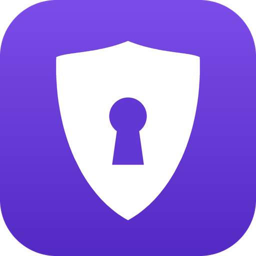
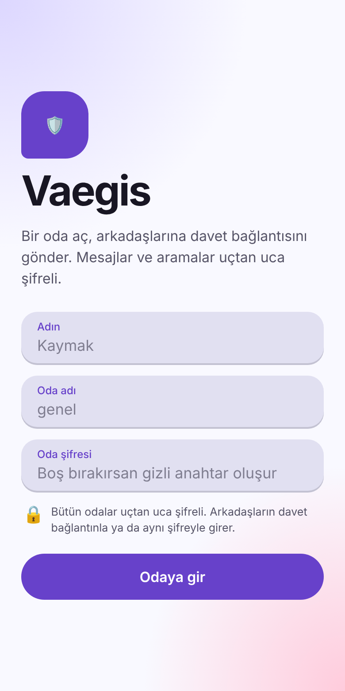
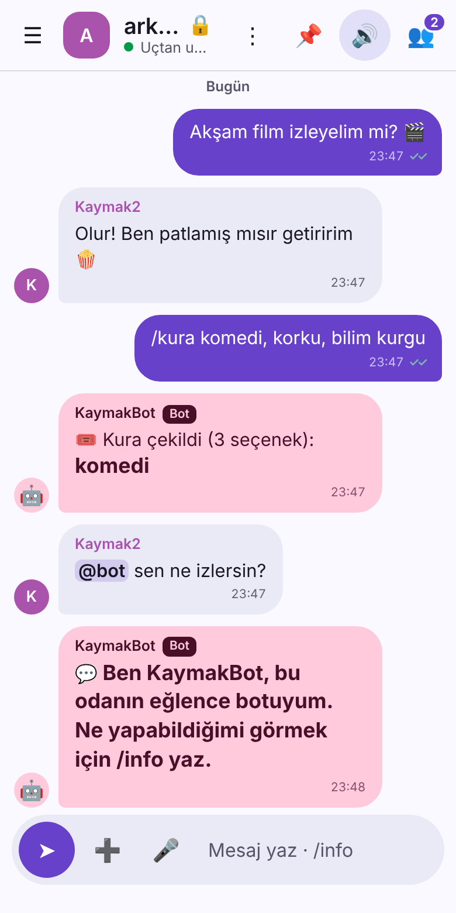
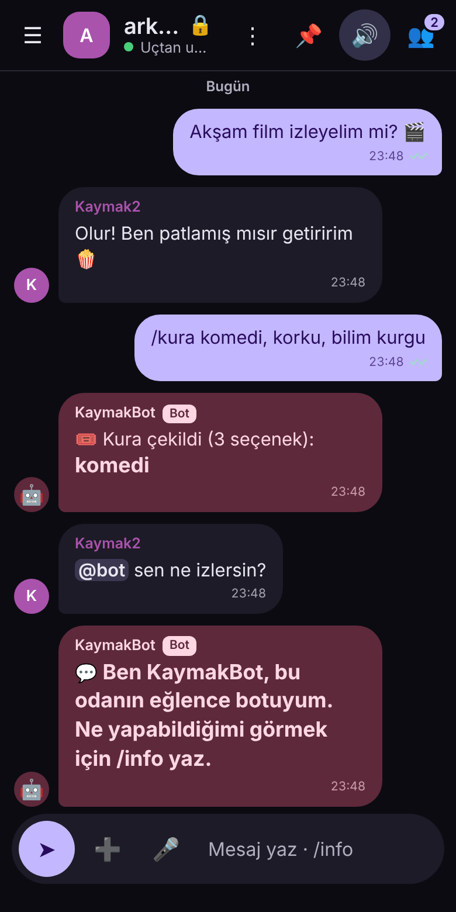
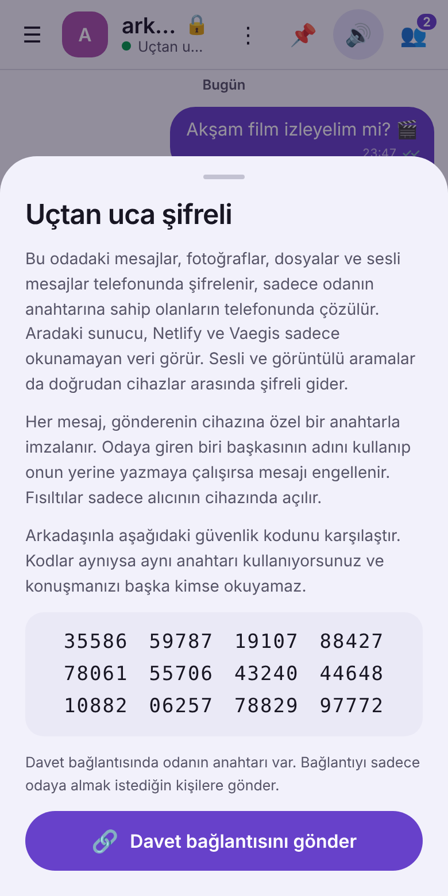
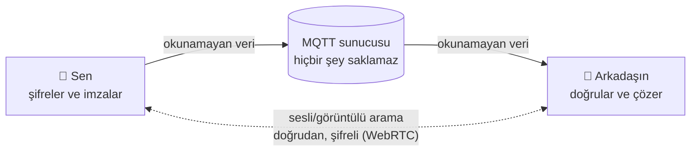

<div align="center">



# Vaegis

**Uçtan uca şifreli mesajlaşma, sesli sohbet ve birlikte video izleme.**<br>
Hesap yok, kurulum yok, mesajların saklandığı bir sunucu yok. Bir oda aç, bağlantıyı gönder, konuşmaya başla.

[](https://vaegischat.vercel.app)


[Özellikler](#özellikler) · [Nasıl çalışır](#nasıl-çalışır) · [Güvenlik](#güvenlik) · [Proje yapısı](#proje-yapısı)

</div>

<br>

<table>
  <tr>
    <td align="center"><br><sub>Giriş</sub></td>
    <td align="center"><br><sub>Sohbet ve KaymakBot</sub></td>
    <td align="center"><br><sub>Koyu tema</sub></td>
    <td align="center"><br><sub>Güvenlik kodu</sub></td>
  </tr>
</table>

## Vaegis nedir?

Vaegis, tarayıcıda çalışan bir sohbet uygulaması. Arkadaşlarınla bir oda açarsın, davet bağlantısını gönderirsin; mesajlar, fotoğraflar, sesli mesajlar ve aramalar telefonunda şifrelenip sadece odadakilerin telefonunda açılır. Aradaki sunucu yalnızca okunamayan veri taşır, hiçbir şeyi saklamaz.

Uygulama tek bir HTML dosyası ve birkaç yardımcı dosyadan oluşur. Derlemesi, veritabanı ya da arka uç sunucusu yoktur; herhangi bir statik barındırma hizmetine olduğu gibi yüklenir.

## Özellikler

### 💬 Mesajlaşma
- Yazı, fotoğraf (birden çok), dosya, konum, çizim ve sesli mesaj
- Yanıtlama, düzenleme, silme, tepki, yıldızlama, sabitleme ve arama
- Anket, kaybolan mesajlar, zamanlanmış mesaj, sesle yazma
- **Kalın**, *italik*, ~~çizili~~, `kod`, ||spoiler|| ve alıntı biçimleri
- Görüldü tikleri, "yazıyor" göstergesi, bağlantı yokken sıraya alma

### 🔒 Güvenlik
- Her oda uçtan uca şifreli; anahtar davet bağlantısının içinde gelir
- Her mesaj gönderenin cihazına özel anahtarla imzalanır, başkası adına yazılamaz
- Fısıltılar sadece alıcının cihazında açılır
- Arkadaşınla karşılaştırabileceğin 60 haneli güvenlik kodu
- Gizlilik ekranı, tek dokunuşla tüm verileri silme, zayıf şifre uyarısı

### 🎙️ Sesli ve görüntülü sohbet
- Sesli arama, kamera ve ekran paylaşımı (en fazla 8 kişi)
- 12 efektli ses değiştirici: robot, kalın, ince, canavar, uzaylı, helyum ve dahası
- Kişi başına ses düzeyi (%0–200) ve susturma
- El kaldırma, bas-konuş, gürültü engelleme, mikrofon ve hoparlör seçimi
- Herkesin duyduğu ses efekti düğmeleri

### 🎬 Birlikte izle
- YouTube videolarını odadaki herkesle aynı anda izleme
- Videoyu "host" kontrol eder; diğerleri otomatik olarak aynı saniyeye eşitlenir
- Ortak video sırası, kontrolü devretme ya da isteme, video üstünde uçan emoji tepkileri

### 🤖 KaymakBot
Sohbete `/` yazınca açılır, `/info` hepsini listeler. Bazıları:

| Komut | Ne yapar |
|---|---|
| `/xox` | XOX oyunu |
| `/tahmin` | Sayı tahmin oyunu, herkes katılır |
| `/tkm taş` | Taş kağıt makas |
| `/bilmece` | Bilmece, cevap 15 saniye sonra |
| `/doğruluk` · `/cesaret` | Doğruluk ya da cesaret |
| `/kura a, b, c` · `/takım 2 ...` | Kura çekme ve takım bölme |
| `/hesap 12*(3+4)` | Hesap makinesi |
| `/konfeti` · `/yağmur 🍕` | Herkesin ekranında efekt |
| `/izle bağlantı` | Birlikte izlemeyi başlatır |

Mesajında `@bot` geçerse bot sana cevap verir.

### 📱 Uygulama
- Ana ekrana eklenebilir (PWA), bildirim gönderir
- Açık ve koyu tema, duvar kağıdı, yazı boyutu
- Kendine özgü ses kimliği: bütün arayüz sesleri aynı tınıdan üretildi
- Yeni sürüm yayınlanınca açık olan uygulamada "Şimdi güncelle" uyarısı

## Nasıl çalışır?



- **Mesajlar** herkese açık bir MQTT sunucusu ([HiveMQ](https://www.hivemq.com/mqtt/public-mqtt-broker/)) üzerinden gider. Sunucu sadece şifreli veri görür; oda adı, kullanıcı adları ve mesaj türü bile şifrenin içindedir.
- **Aramalar** WebRTC ile doğrudan cihazlar arasında kurulur, ses ve görüntü sunucudan geçmez.
- **Geçmiş** sadece cihazlarda tutulur. Odaya sonradan giren biri, geçmişi odadaki diğer cihazlardan imzalı olarak alır.

## Güvenlik

| Konu | Nasıl |
|---|---|
| Oda anahtarı | Rastgele 144 bitlik anahtar ya da şifreden PBKDF2-SHA256 (250.000 tur) ile türetilir |
| Davet bağlantısı | Anahtar adresin `#` kısmındadır; bu kısım ne barındırma sunucusuna ne mesaj sunucusuna gönderilir |
| Mesaj şifreleme | AES-256-GCM, oda etiketine bağlı (AAD) |
| Kimlik | Her cihazın ECDSA P-256 imza anahtarı vardır; bir kişinin anahtarı ilk görüldüğü anda hatırlanır, farklı anahtarla gelen mesaj engellenir |
| Fısıltı | ECDH P-256 ile sadece alıcının anahtarıyla şifrelenir |
| Tekrar gönderme | 10 dakikadan eski ya da daha önce görülmüş zarflar reddedilir |
| Boyut gizleme | Bütün türler tek kanaldan gider, boyutlar 256 / 4096 bayta yuvarlanır |
| Aramalar | WebRTC (DTLS-SRTP), doğrudan cihazlar arası |
| Tarayıcı | Sıkı CSP, başka sitelere gömülme engeli, `no-referrer` |

**Bilmen gerekenler**
- Davet bağlantısını alan herkes odaya girebilir; bağlantıyı sadece güvendiğin kişilere gönder.
- Oda anahtarı sabittir. Anahtarı ele geçiren biri, o andan sonra ulaşan mesajları okuyabilir (ileriye dönük gizlilik yoktur).
- Mesaj sunucusu içeriği göremez ama kimin ne zaman bağlandığını (IP adresi, zaman) görebilir.
- TURN sunucusu olmadığı için bazı sıkı kurumsal ya da mobil ağlarda aramalar bağlanmayabilir.

## Proje yapısı

```
├── index.html              Uygulamanın tamamı (arayüz, şifreleme, arama, bot)
├── ses-efekt.js            Ses değiştirici için gerçek zamanlı perde kaydırma (AudioWorklet)
├── sw.js                   Çevrimdışı çalışma ve güncelleme (service worker)
├── manifest.webmanifest    Ana ekrana ekleme bilgileri
├── icon-*.png              Uygulama simgeleri
├── sesler/                 Arayüz ve efekt sesleri (+ liste.json)
├── _headers                Netlify güvenlik başlıkları
├── vercel.json             Vercel güvenlik başlıkları
└── docs/                   README ekran görüntüleri
```

## Kullanılanlar

[mqtt.js](https://github.com/mqttjs/MQTT.js) · [HiveMQ açık MQTT sunucusu](https://www.hivemq.com/mqtt/public-mqtt-broker/) · Web Crypto API · WebRTC · Web Audio API · [Material Symbols](https://fonts.google.com/icons) · [Rubik](https://fonts.google.com/specimen/Rubik) · [YouTube IFrame API](https://developers.google.com/youtube/iframe_api_reference) · [OpenStreetMap](https://www.openstreetmap.org/copyright)

<div align="center">
<br>
<sub>By LegendKaymak</sub>
</div>
